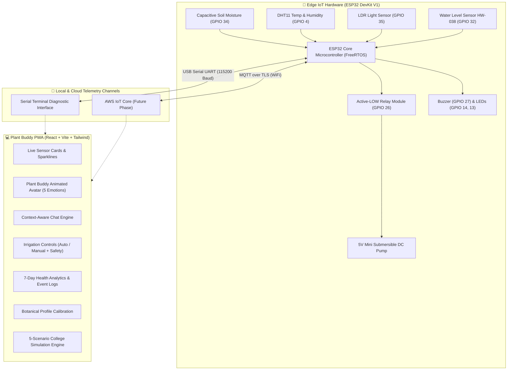

# 🌱 Plant Buddy (WaterWise 2.0) — AI-Powered IoT Plant Companion

> **An intelligent, responsive, cloud-ready plant monitoring and companion system.**  
> Plant Buddy bridges embedded IoT sensors (ESP32) with a digital companion persona, expressing the plant's physiological condition through animated emotions, contextual speech, automated care intelligence, and multi-tier fail-safe irrigation.

---

## 📑 Table of Contents
1. [Project Overview](#-project-overview)
2. [End-to-End System Architecture](#-end-to-end-system-architecture)
3. [Hardware Bill of Materials & Pinout Map](#-hardware-bill-of-materials--pinout-map)
4. [Hardware Terminal Verification & Commands](#-hardware-terminal-verification--commands)
5. [Firmware Build & Flashing Guide](#-firmware-build--flashing-guide)
6. [Frontend Progressive Web App (PWA) Guide](#-frontend-progressive-web-app-pwa-guide)
7. [Digital Companion Emotional Engine](#-digital-companion-emotional-engine)
8. [Multi-Tier Safety & Irrigation Architecture](#-multi-tier-safety--irrigation-architecture)
9. [College Project Demonstration & Simulation Guide](#-college-project-demonstration--simulation-guide)
10. [AWS IoT Core Cloud Architecture (Roadmap)](#-aws-iot-core-cloud-architecture-roadmap)
11. [Troubleshooting & Diagnostics Guide](#-troubleshooting--diagnostics-guide)

---

## 🌿 Project Overview

Traditional IoT agriculture dashboards simply display cold numbers. **Plant Buddy** gives the plant an expressive digital personality:
- **😊 Happy & Thriving**: When soil moisture, temperature, and lighting are within botanical target ranges.
- **🥺 Thirsty**: When soil moisture falls below the species watering threshold.
- **🥵 Hot / Heat Stressed**: When ambient temperature exceeds comfortable transpiration limits.
- **😟 Sad / Low Light**: When ambient light levels drop below photosynthetic requirements.
- **⚠️ Warning / Reservoir Alert**: When the water reservoir tank is critically low, triggering automatic pump lockout.

The plant communicates dynamically through an animated SVG character, contextual speech bubbles, rule-based chatbot assistance, and automated watering control.

---

## 🏗 End-to-End System Architecture



---

## 🔌 Hardware Bill of Materials & Pinout Map

| Component | Pin Label | ESP32 GPIO | ADC Channel / Type | Operating Voltage | Protection / Resistor Required | Hardware Safety Notes |
| :--- | :--- | :--- | :--- | :--- | :--- | :--- |
| **Capacitive Soil Moisture** | AOUT | **GPIO 34** | ADC1_CH6 (Safe with WiFi) | 3.3V | None | Analog voltage decreases as moisture increases (~3000 dry, ~1500 wet). |
| **DHT11 Temperature & RH** | DATA / OUT | **GPIO 4** | Digital I/O | 3.3V or 5V | 4.7kΩ–10kΩ pull-up to VCC | Single-wire bidirectional bus. Ensure solid pin contact. |
| **LDR Light Module** | AOUT | **GPIO 35** | ADC1_CH7 (Safe with WiFi) | 3.3V | Built-in 10kΩ divider | Raw ADC 0–1023. Not lux (certified lux requires BH1750 I2C). |
| **Water Level Sensor** | SIG / OUT | **GPIO 32** | ADC1_CH4 (Safe with WiFi) | 3.3V | None if 3.3V; divider if 5V | Submerged depth yields analog voltage (0 = dry air/empty tank). |
| **5V Relay Module** | IN | **GPIO 26** | Digital Output | 5V VCC, 3.3V IN | None | **Active-LOW** (`LOW = ON`, `HIGH = OFF`). Default boot state is `HIGH`. |
| **Active/Passive Buzzer** | I/O / + | **GPIO 27** | Digital Output | 3.3V / 5V | Optional current limit | Pulsed alarm on water shortage or extreme stress. |
| **Green Status LED** | Anode (+) | **GPIO 14** | Digital Output | 3.3V | 220Ω – 330Ω in series | Indicates healthy plant conditions. |
| **Red Warning LED** | Anode (+) | **GPIO 13** | Digital Output | 3.3V | 220Ω – 330Ω in series | Indicates dry soil, low tank, or sensor fault. |
| **5V DC Mini Pump** | V+ / V- | Relay COM/NO | Actuator Load | External 5V DC | Separate power supply | **NEVER power the DC motor directly from ESP32 3.3V pin.** |

> [!IMPORTANT]
> **ADC1 vs. ADC2 WiFi Safety**: All analog sensors (Soil on GPIO 34, LDR on GPIO 35, Water on GPIO 32) utilize **ADC1**. On the ESP32, ADC2 pins are disabled when the Wi-Fi module is transmitting to AWS IoT Core. Because only ADC1 pins are used for analog input, all sensor readings remain 100% stable during cloud transmission.

---

## 💻 Hardware Terminal Verification & Commands

All commands can be run directly from your computer terminal (macOS, Linux, or Windows PowerShell).

### 1. Detect Connected ESP32 USB Port
To confirm the ESP32 is recognized by your operating system:

```bash
# macOS
ls -la /dev/cu.usbserial*
# Output: /dev/cu.usbserial-0001 (Silicon Labs CP2102)

# Linux
ls -la /dev/ttyUSB*

# PlatformIO Device List (All Platforms)
pio device list
```

### 2. Live Terminal Sensor Telemetry (Without Uploading)
To read the live serial stream directly from the ESP32 at 115200 baud without modifying code:

```bash
# Using Python (Cross-platform)
python3 -c "
import serial, time
s = serial.Serial('/dev/cu.usbserial-0001', 115200, timeout=1)
s.reset_input_buffer()
t0 = time.time()
while time.time() - t0 < 10:
    line = s.readline()
    if line:
        print(line.decode('utf-8', errors='replace'), end='')
s.close()
"
```

**Expected Terminal Output:**
```text
------------------------------------
Soil moisture raw:  4095
Light raw:          412
Water level raw:    0
DHT11: ERROR - check wiring/sensor
Plant status: SAD / THIRSTY
Light status: LOW - needs more light
Water tank:   LOW - refill needed
Pump: OFF
```

---

## ⚡ Firmware Build & Flashing Guide

The embedded firmware is built using **PlatformIO** with the Arduino framework.

### Project Files:
- [`src/main.cpp`](file:///Users/vinayaksaindane/Documents/WaterWise/src/main.cpp): Core firmware (sensing loops, relay logic, safety timers).
- [`include/config.h`](file:///Users/vinayaksaindane/Documents/WaterWise/include/config.h): Central hardware configuration, pin mapping, thresholds.
- [`include/secrets.h.template`](file:///Users/vinayaksaindane/Documents/WaterWise/include/secrets.h.template): Wi-Fi & MQTT credentials template.
- [`platformio.ini`](file:///Users/vinayaksaindane/Documents/WaterWise/platformio.ini): Board definition, port speed, and library dependencies.

### 1. Compile the Firmware
```bash
# From the project root (/Users/.../WaterWise)
pio run
```
*Expected: `[SUCCESS]` (Uses ~23% Flash and ~6.8% RAM).*

### 2. Upload Firmware to ESP32
```bash
# Flash the ESP32 over USB
pio run -t upload
```

### 3. Open Interactive Serial Monitor
```bash
# Open interactive serial console at 115200 baud
pio device monitor -b 115200
```
*(Press `Ctrl+]` or `Ctrl+C` to exit the monitor).*

---

## 🌐 Frontend Progressive Web App (PWA) Guide

The frontend is a Progressive Web Application located in [`frontend/`](file:///Users/vinayaksaindane/Documents/WaterWise/frontend).

### Tech Stack:
- **React 19** + **TypeScript**
- **Vite 8**
- **Tailwind CSS v4**
- **Recharts** (Real-time analytics and multi-axis correlation)
- **Lucide Icons**
- **VitePWA** (Installable on iOS, Android, and Desktop Chrome)

### 1. Install Frontend Dependencies
```bash
cd frontend
npm install
```

### 2. Run Local Development Server
```bash
npm run dev -- --host 127.0.0.1 --port 5173
```
- Open your browser to: **[http://127.0.0.1:5173/](http://127.0.0.1:5173/)**
- Open Chrome DevTools (`Cmd+Option+I` / `F12`) and toggle Mobile Device Toolbar (`Cmd+Shift+M`) to preview in iPhone/Android viewports.

### 3. Build & Test Production Bundle
```bash
# Type check and build optimized bundle
npm run build

# Preview production build locally
npm run preview
```

---

## 🎭 Digital Companion Emotional Engine

The virtual Plant Buddy avatar (`PlantAvatar.tsx`) evaluates sensor values against species-specific botanical baselines to derive an overall health score (0–100) and an active emotional expression:

| Emotion | Trigger Condition | Visual Avatar Expression | Speech Bubble Personality |
| :--- | :--- | :--- | :--- |
| **😊 Happy** | Soil, temp, light & tank within target range (Score &ge; 75) | Perky leaves, wide smile, blinking eyes, rosy cheeks | *"I'm feeling fantastic! Soil moisture is 60% and warmth is ideal. Thanks for taking such great care of me!"* |
| **🥺 Thirsty** | Soil moisture &lt; Species watering threshold | Drooping leaves, pleading eyes, quivering mouth, water tear | *"My soil moisture is down to 18%. I'm getting quite thirsty! Could you give me some water?"* |
| **🥵 Hot / Stressed** | Ambient temperature &gt; Preferred Max + 3°C | Flushed red cheeks, panting tongue, squinting eyes | *"Whew, it's 36.8°C! That's too toasty for a Monstera. Mind moving me somewhere cooler?"* |
| **😟 Sad / Dim** | Light level &lt; Minimum Floor or composite score &lt; 60 | Subdued droop, downturned mouth, half-closed eyes | *"It's pretty dim here (reading: 130). Could you move me closer to the window or turn on a grow light?"* |
| **⚠️ Warning** | Water reservoir &lt; 20% | Wide alert eyes, nervous straight mouth, warning emblem | *"Heads up! My water reservoir is down to 8%. Please refill it so I can stay hydrated!"* |

---

## 🛡 Multi-Tier Safety & Irrigation Architecture

To prevent pump burnout, flooding, or hardware damage, safety is enforced in both firmware and frontend:

1. **Active-LOW Relay Boot Safety**: In `setup()`, the ESP32 drives GPIO 26 `HIGH` before enabling the output pin, eliminating bootloader switching spikes.
2. **Hard Runtime Limit (5 Seconds)**: The pump is software-capped to a maximum of 5,000 ms per cycle, preventing flooding if connection drops.
3. **Mandatory Cooldown (30 Seconds)**: After any watering cycle, all trigger requests are locked for 30,000 ms to allow water percolation.
4. **Dry-Run Tank Lockout**: If the water reservoir drops below 20% (ADC &lt; 500), watering commands are automatically blocked.
5. **Emergency Stop**: The UI provides an instantaneous manual kill switch.

---

## 🎓 College Project Demonstration & Simulation Guide

When demonstrating this project to professors, evaluators, or classmates without live soil and water, use the **Simulation Control Panel**:

1. Open **[http://127.0.0.1:5173/](http://127.0.0.1:5173/)**.
2. Click the top-right badge: **`SIMULATED (HEALTHY)`**.
3. Test the 5 Pre-configured Scenarios:
   - **Scenario 1 (Healthy)**: Demonstrates the happy avatar, optimal gauges, and positive dialogue.
   - **Scenario 2 (Thirsty)**: Demonstrates low moisture (18%), sad/thirsty avatar, and automated irrigation trigger.
   - **Scenario 3 (Scorching Heat)**: Demonstrates heat-stress avatar, elevated temperature (36.8°C), and cooling recommendations.
   - **Scenario 4 (Night / Low Light)**: Demonstrates dim lighting (130/1023), reduced health index, and sunlight suggestions.
   - **Scenario 5 (Low Water Tank)**: Demonstrates empty reservoir (8%), warning avatar face, and **automatic lockout of watering controls**.
4. Test the **Interactive Chat**: Type queries like:
   - *"Do you need water?"*
   - *"Why are you sad?"*
   - *"Is the temperature suitable?"*
   - *"When did I last water you?"*

---

## ☁️ AWS IoT Core Cloud Architecture (Roadmap)

When transitioning to full cloud connectivity:

```text
ESP32 (MQTT Client over TLS 1.2)
   │
   ▼
AWS IoT Core (Broker)
   │
   ├── Topic: plantbuddy/plant-001/telemetry  (Publishes sensor readings every 5s)
   ├── Topic: plantbuddy/plant-001/status     (Publishes device online/offline LWT)
   ├── Topic: plantbuddy/plant-001/commands   (Subscribes to remote pump triggers)
   └── Topic: plantbuddy/plant-001/events     (Publishes alerts and threshold breaches)
   │
   ▼
AWS IoT Topic Rule
   │
   ├──▶ AWS Lambda (Processes health algorithms and validates command authorization)
   │       │
   │       ▼
   ├──▶ Amazon DynamoDB (Stores historical telemetry and watering audit records)
   │
   ▼
Amazon API Gateway / WebSockets ──▶ React Plant Buddy PWA
```

---

## 🔧 Troubleshooting & Diagnostics Guide

### 1. DHT11 Reports `DHT11: ERROR - check wiring/sensor`
- **Cause**: Single-wire pulse communication timed out.
- **Remedy**:
  1. Verify the DHT11 data pin is connected to **ESP32 GPIO 4**.
  2. Verify VCC is connected to **3.3V or 5V** and GND is connected to **GND**.
  3. If using a bare 4-pin DHT11 sensor, install a **10kΩ pull-up resistor** between VCC and DATA.
  4. Ensure jumper wires make solid contact with the breadboard.

### 2. Soil Moisture Always Reads `4095`
- **Cause**: The sensor is currently in dry air (max resistance).
- **Remedy**: Dip the probe into a cup of water or moist soil; verify the raw ADC value drops towards ~1500–1800.

### 3. Water Level Always Reads `0`
- **Cause**: Sensor PCB traces are dry.
- **Remedy**: Submerge the bottom half of the sensor in water; verify the reading climbs past 500.

### 4. Red LED Pin Assignment (GPIO 13 vs GPIO 25)
- In [`src/main.cpp`](file:///Users/vinayaksaindane/Documents/WaterWise/src/main.cpp#L20), `RED_LED_PIN` is currently mapped to **GPIO 13**.
- If your breadboard connects the Red LED resistor to **GPIO 25**, update line 20 of `src/main.cpp` to `#define RED_LED_PIN 25`.

---

## 👨‍💻 Project Contributor
- **Lead Developer**: Vinayak Saindane
- **Project**: WaterWise 2.0 / Plant Buddy IoT
- **Framework**: PlatformIO / Arduino / React PWA / AWS IoT Core

